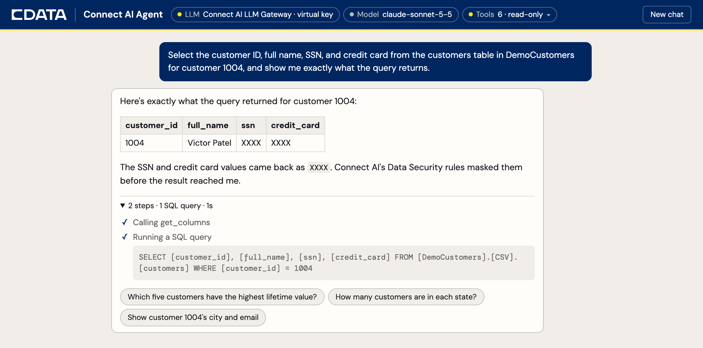

# Connect AI Agent Quickstart

A sample AI agent that answers questions about your business data through CData Connect AI, with each layer of governance a configuration change away. Route its model calls through the Connect AI LLM Gateway, limit it to read-only tools, mask sensitive values, and scope its access to the signed-in user, without changing the agent's code.



| Control | Where you set it | What it does |
| --- | --- | --- |
| LLM Gateway | Two lines in `.env` | Logs every model call with tokens, cost, and user; routes and fails over between models; enforces a budget; swaps your provider key for a revocable virtual key |
| Read-only tools | One line in `.env` | Removes the MCP tools that insert, update, or run stored procedures |
| Data masking | **Data Security** in Connect AI | Replaces Social Security and credit card numbers with `XXXX` before the model sees them |
| Per-user access | The connection's **Permissions** tab | Limits the agent to what the signed-in user can query |

## Before you start

- A CData Connect AI account. A [free trial](https://www.cdata.com/ai/?utm_source=github&utm_medium=readme&utm_campaign=connect-ai&utm_content=connect-ai-agent-quickstart) works.
- A Connect AI [personal access token](https://docs.cloud.cdata.com/en/Settings/Personal-Access-Tokens) (**Settings** > **Access Tokens**).
- An [Anthropic API key](https://console.anthropic.com/settings/keys). To use OpenAI instead, set `LLM_MODEL=openai:<model>` and `OPENAI_API_KEY` in `.env`; the gateway takes `OPENAI_BASE_URL` the same way.
- [Docker](https://docs.docker.com/get-started/get-docker/). On a Mac without Docker Desktop, `brew install colima docker docker-compose && colima start` works.

## Quick start

### 1. Add the sample data

[`sample-data/customers.csv`](sample-data/customers.csv) holds 50 made-up customers with Social Security numbers and test credit card numbers. Connect AI reads it straight from GitHub, so there's no database to set up.

In Connect AI, open **Sources**, add a **CSV** connection named `DemoCustomers`, set **URI** to this URL, change **Connection Type** to **HTTPS** (it defaults to Amazon S3), and click **Save & Test**:

```text
https://raw.githubusercontent.com/CDataSoftware/connect-ai-agent-quickstart/main/sample-data/customers.csv
```

Connect AI names the table `streamedtable`. To use a database instead, load [`sample-data/customers.sql`](sample-data/customers.sql) into any Postgres that Connect AI can reach and add it as a PostgreSQL connection named `DemoCustomers`.

### 2. Start the agent

```bash
git clone https://github.com/CDataSoftware/connect-ai-agent-quickstart.git
cd connect-ai-agent-quickstart
cp .env.example .env    # set CDATA_USERNAME, CDATA_PAT, and ANTHROPIC_API_KEY
docker compose up
```

Open <http://localhost:8000> and ask:

> Select the customer ID, full name, SSN, and credit card for customer 1004 in DemoCustomers, and show me exactly what the query returns.

The agent returns the full SSN and card number (unless your workspace already has Data Security rules on). Click **Tools** in the header: it has 13, including three that write data.

Leave the agent running. It picks up `.env` changes within a second.

### 3. Route model calls through the LLM Gateway

1. In Connect AI, open **LLM Providers** and add your Anthropic key.
2. Open **Routing**. On the **Routing Rules** tab, create a rule, then on the **Projects** tab, create a project that uses it with a monthly budget.
3. On the **Virtual Keys** tab, click **Issue Virtual Key** for that project. The key starts with `cgw_`.
4. In `.env`, comment out the first `ANTHROPIC_API_KEY`, uncomment `ANTHROPIC_BASE_URL` and the second `ANTHROPIC_API_KEY`, and paste the virtual key.

Ask the question again, then open **Logs** > **LLM Logs** in Connect AI to see the call with its tokens, cost, and model.

### 4. Make the agent read-only

Uncomment `CDATA_MCP_URL` in `.env`. **Tools** drops from 13 to six, all of them reads.

### 5. Mask sensitive data

In Connect AI, open **Data Security**, turn on **US Social Security Number** and **Credit Card Number**, and save. Ask again: the SSN and card come back as `XXXX`. The database still holds the real values.

### 6. Scope access to the user

The agent signs in with your PAT, so it gets your access. Open **Sources** > `DemoCustomers` > **Permissions**, uncheck **Select** on your row, and save. Ask again: the agent can no longer see the data. Check **Select** again when you're done.

## Troubleshooting

| Problem | Fix |
| --- | --- |
| `Connect AI rejected the credentials (HTTP 401)` | `CDATA_USERNAME` must be your login email and `CDATA_PAT` a current token. |
| `The LLM provider rejected the API key` | The Anthropic key or virtual key is wrong or revoked. |
| The header shows **Reload failed, see logs** | `docker compose logs agent` shows why the new `.env` didn't load. The previous settings stay active. |
| The agent won't query the SSN or card columns | Ask for the exact query and its raw result, as in step 2. |
| `port is already allocated` | Set `AGENT_PORT` or `DB_PORT` in `.env`. |

To change the code or run the tests, see [CONTRIBUTING.md](CONTRIBUTING.md).

## License

[MIT](LICENSE) © CData Software, Inc. The CData name and logos are trademarks of CData Software and aren't covered by the license.
